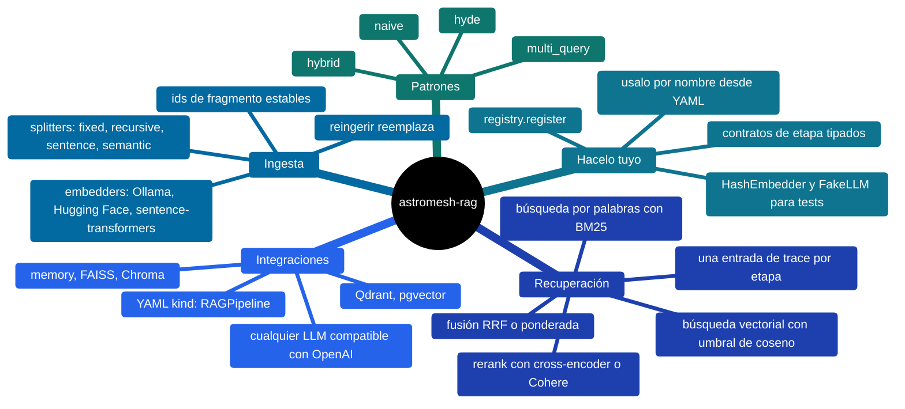
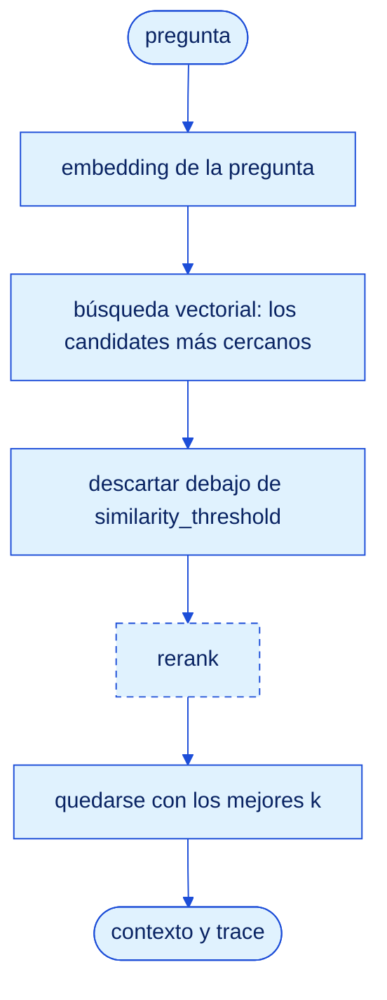
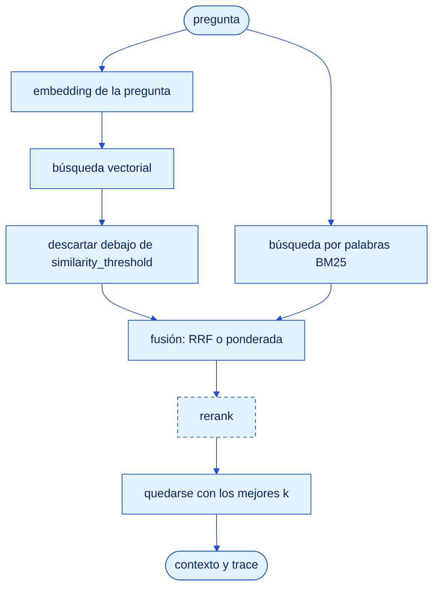
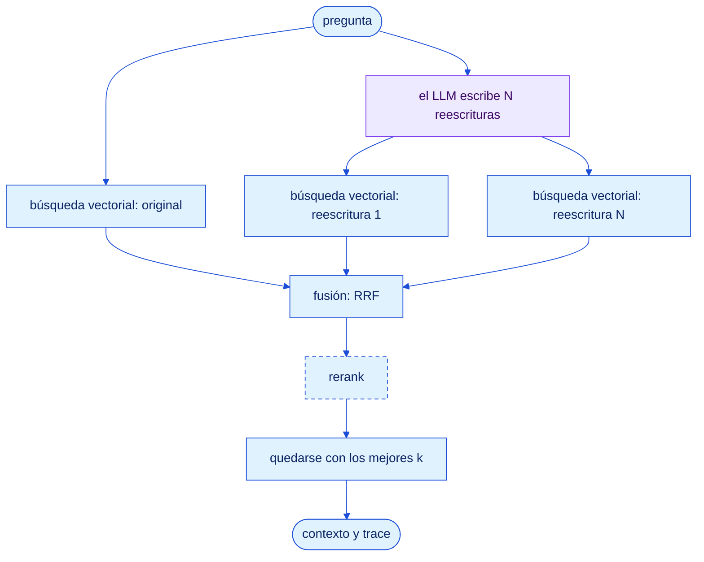
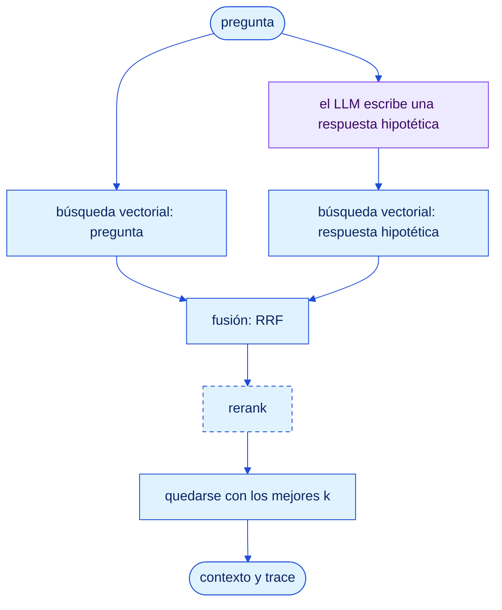
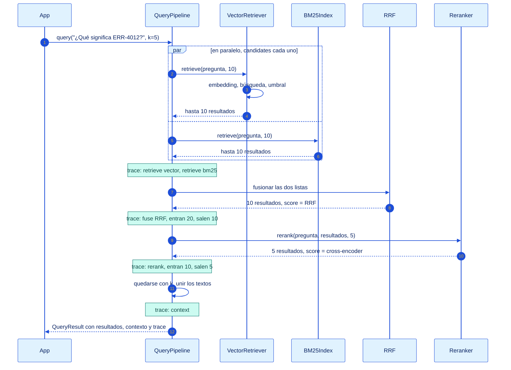

<p align="center">
  
</p>

# astromesh-rag

**Todos los patrones de RAG, un solo juego de piezas.**

[](https://monaccode.github.io/astromesh/#ecosystem)
[](https://github.com/monaccode/astromesh-rag/releases)
[](https://github.com/monaccode/astromesh-rag/actions/workflows/ci.yml)
[](https://pypi.org/project/astromesh-rag/)
[](https://pypi.org/project/astromesh-rag/)
[](https://github.com/monaccode/astromesh-rag/blob/main/LICENSE)

*[Read in English](https://github.com/monaccode/astromesh-rag/blob/main/README.md)*

La generación aumentada por recuperación (RAG) le da a un modelo los documentos que
necesita para responder, en el momento en que responde. Todo sistema de RAG hace las
mismas cuatro cosas:

1. **Ingerir.** Partir tus documentos en fragmentos (chunks), convertir cada uno en un
   vector y guardarlo.
2. **Recuperar.** Convertir la pregunta en un vector y buscar los fragmentos más cercanos;
   si querés, buscar también por palabras clave, o dejar que un LLM reescriba la pregunta.
3. **Ordenar.** Unir las listas, reordenar los candidatos con un modelo más fino y quedarse
   con los mejores `k`.
4. **Responder.** Juntar los ganadores en un bloque de contexto que tu modelo lee antes de
   contestar.

`astromesh-rag` arma cada uno de esos pasos con piezas chicas e intercambiables, en Python
o en YAML. Los patrones (`naive`, `hybrid`, `multi_query`, `hyde`) son distintas formas de
conectar las mismas piezas: cambiás de patrón tocando una línea y ves en el `trace` qué
hizo exactamente cada etapa. La biblioteca en sí depende sólo de PyYAML; cada modelo y cada base de
datos es un extra opcional.



## Patrones

Un patrón decide cómo la pregunta se convierte en candidatos. Todo lo que viene después
(fusión, rerank opcional, los mejores `k`, el contexto) es compartido.

| Patrón | Pensado para | Trabajo por consulta | ¿Necesita un LLM? |
|---|---|---|---|
| `naive` | Preguntas escritas como los documentos | 1 embedding, 1 búsqueda vectorial | No |
| `hybrid` | Tokens exactos: códigos de error, SKUs, nombres, versiones | 1 embedding, vectorial y BM25 en paralelo, fusión | No |
| `multi_query` | Usuarios que lo dicen distinto que la documentación | 1 llamada al LLM, después 1 + N embeddings y búsquedas, fusión | Sí |
| `hyde` | Preguntas cortas contra textos de referencia largos | 1 llamada al LLM, después 2 embeddings y búsquedas, fusión | Sí |

El rerank se prende en cualquier patrón: un cross-encoder (o Cohere) vuelve a puntuar los
candidatos, lo que cuesta una pasada más de modelo sobre `candidates` textos. Toda búsqueda
vectorial descarta los resultados por debajo de `similarity_threshold` si lo definís. En
los diagramas, las cajas punteadas son opcionales y las violetas llaman al LLM.

### naive

Hace el embedding de la pregunta y toma los fragmentos más cercanos.



### hybrid

La búsqueda vectorial y la búsqueda por palabras con BM25 corren a la vez; la fusión por
rango recíproco (RRF) une los dos rankings. BM25 es lo que encuentra `ERR-4012` cuando el
embedding no lo distingue de `ERR-4013`.



### multi_query

Un LLM reescribe la pregunta de N maneras (3 por defecto). Se busca la original y cada
reescritura, y RRF premia los fragmentos en los que coinciden varias formulaciones.



### hyde

Embeddings de documento hipotético: un LLM escribe el pasaje que *respondería* la pregunta,
y ese pasaje se busca junto a la pregunta misma. Un párrafo se parece más a un párrafo que
una pregunta de una línea.



Idea, etapas, YAML y modos de falla de cada uno:
**[docs/patterns.md](https://github.com/monaccode/astromesh-rag/blob/main/docs/patterns.md)**
(en inglés).

## Una consulta hybrid, etapa por etapa

Cada consulta devuelve un `QueryResult` con los resultados, el contexto y un `trace`: una
entrada por etapa (las notas verdes de abajo) con su nombre, el tiempo en milisegundos,
cuántos elementos entraron y salieron, y el error si falló. En `hybrid`, si falla un
retriever queda registrado en el trace y se usan los resultados del otro; sólo si fallan
los dos se lanza `StageError`.



Cada resultado conserva en `details` todos los puntajes que acumuló (`vector`, `bm25`,
`rrf`, `rerank`) y dice quién lo encontró en `source` (`vector`, `bm25` o `bm25+vector`).

## Benchmark

¿Qué patrón conviene usar? El repo trae un corpus simulado, construido para que la
recuperación falle de maneras concretas y etiquetadas, y un script que rankea los cuatro
patrones sobre él, con y sin reranker.

**El corpus.** [Nimbus](https://github.com/monaccode/astromesh-rag/blob/main/examples/corpus/README.md)
es la documentación de un servicio ficticio de almacenamiento en la nube: 200 documentos
(primero en español, alrededor de 20 % en inglés) y 60 preguntas etiquetadas a mano.

| Familia | Docs | Trampa | Qué lo hace difícil |
|---|---|---|---|
| Artículos de error | 40 | `exact` | Códigos hermanos (`ERR-4012` / `ERR-4013`) comparten casi todas las palabras |
| Planes | 20 | `exact` | Los SKUs mensuales y anuales sólo difieren en límites y precio |
| FAQs de facturación y cuenta | 50 | `paraphrase` | Vocabulario formal que las preguntas coloquiales nunca usan |
| Políticas 2024 y 2026 | 30 | `distractor` | Mismo título y texto, distintos números; la de 2024 está reemplazada |
| Notas de versión y posts de blog | 60 | `noise` | Repiten palabras del producto y códigos de error sin responder nada |

**Las preguntas** tienen los mismos tipos: 15 `exact` ("¿Qué significa ERR-4012?"),
20 `paraphrase` ("me cobraron dos veces este mes"), 15 `distractor` (sólo cuenta como
correcta la política 2026) y 10 `noise`. Cada tipo lleva una hipótesis (BM25 gana con los
códigos, las reescrituras ganan con las paráfrasis, un reranker separa versiones y baja el
ruido) que la corrida confirma o refuta.

**Métricas.** Los rankings se evalúan por documento (los fragmentos se deduplican a su
documento): recall@5, precision@5 y hit rate@5, MRR@10 y nDCG@10, más la latencia p50/p95
de una llamada a `query()` y las llamadas al LLM por consulta.

**Modelos.** Embeddings: `sentence-transformers/all-MiniLM-L6-v2`. Reranker:
`cross-encoder/ms-marco-MiniLM-L-6-v2`. LLM para `multi_query` y `hyde`: Kimi a través de
una pasarela compatible con OpenAI.

<!-- BENCHMARK_RESULTS -->

**Reproducirlo.**

```bash
git clone https://github.com/monaccode/astromesh-rag && cd astromesh-rag
uv sync --extra sentence-transformers --extra openai
export RAG_BENCH_BASE_URL=https://your-gateway/v1 RAG_BENCH_API_KEY=... RAG_BENCH_MODEL=...
uv run python examples/benchmark.py --embedder st --rerank both --k 5 --out results/
```

Imprime las tablas general y por tipo, y escribe `results/<fecha>-st.json` con la
configuración, el hash del corpus y cada fila por consulta. Sin `RAG_BENCH_*` usa un LLM
falso, y `--embedder hash` usa un embedder de prueba: los dos corren sin red y los dos
imprimen una advertencia, porque sus puntajes no significan nada.

## Inicio rápido

```bash
pip install 'astromesh-rag[sentence-transformers]'
```

**Python.** Ingerir dos documentos, preguntar con `hybrid`, leer el contexto:

```python
import asyncio

from astromesh_rag import Document
from astromesh_rag.embedders import SentenceTransformersEmbedder
from astromesh_rag.indexes import MemoryIndex
from astromesh_rag.patterns import hybrid
from astromesh_rag.pipeline import IngestPipeline
from astromesh_rag.retrievers import BM25Index
from astromesh_rag.splitters import RecursiveSplitter

docs = [
    Document("ERR-4012: your upload link expired. Request a new one.", id="err-4012"),
    Document("ERR-4013: your storage quota is full. Free space or upgrade.", id="err-4013"),
]


async def main():
    embedder, index, bm25 = SentenceTransformersEmbedder(), MemoryIndex(), BM25Index()
    await IngestPipeline(RecursiveSplitter(), embedder, index, bm25).ingest(docs)
    result = await hybrid(embedder, index, bm25).query("What does ERR-4012 mean?", k=1)
    print(result.context)  # ERR-4012: your upload link expired. Request a new one.
    print(result.trace)  # retrieve vector, retrieve bm25, fuse, context


asyncio.run(main())
```

**YAML.** El mismo formato `kind: RAGPipeline` que carga el runtime de Astromesh:

```yaml
# support.rag.yaml
apiVersion: astromesh/v1
kind: RAGPipeline
metadata:
  name: support-docs
spec:
  chunking: { strategy: recursive, chunk_size: 800, overlap: 80 }
  embeddings: { provider: sentence_transformers, model: all-MiniLM-L6-v2 }
  vector_store: { backend: memory }
  reranking: { enabled: true, provider: cross_encoder, top_k: 5 }
  retrieval:
    pattern: hybrid
    top_k: 5
    candidates: 20
```

```python
from astromesh_rag.spec import build, load_spec_file

pipeline = build(load_spec_file("support.rag.yaml"))
await pipeline.ingest(docs)
result = await pipeline.query("What does ERR-4012 mean?")
```

`multi_query` y `hyde` necesitan un modelo: `build(spec, llm=OpenAICompatLLM(base_url,
api_key, model))` funciona con cualquier endpoint compatible con OpenAI (una pasarela,
Ollama, vLLM, OpenAI). Todas las claves y sus valores por defecto:
**[docs/spec.md](https://github.com/monaccode/astromesh-rag/blob/main/docs/spec.md)** (en inglés).

## Extras

Los splitters, BM25, la fusión, el índice `memory` y los dobles de prueba no necesitan nada
más que PyYAML. Todo lo demás es un extra; si falta uno se lanza `MissingExtraError` con el
`pip install 'astromesh-rag[...]'` exacto, al construir el pipeline (pgvector: al primer
uso).

| Extra | Instala | Habilita |
|---|---|---|
| `sentence-transformers` | `sentence-transformers` | `embeddings.provider: sentence_transformers`, `reranking.provider: cross_encoder` |
| `ollama` | `httpx` | `embeddings.provider: ollama` |
| `hf` | `httpx` | `embeddings.provider: hf` (Inference API o TEI) |
| `faiss` | `faiss-cpu`, `numpy` | `vector_store.backend: faiss` |
| `chroma` | `chromadb` | `vector_store.backend: chroma` |
| `qdrant` | `qdrant-client` | `vector_store.backend: qdrant` |
| `pgvector` | `asyncpg` | `vector_store.backend: pgvector` (se verifica al primer uso) |
| `cohere` | `httpx` | `reranking.provider: cohere` |
| `openai` | `httpx` | `OpenAICompatLLM` para `multi_query` y `hyde` |
| `all` | todo lo anterior | todo |

## Hacelo tuyo

Cada etapa es un protocolo async chico (`Splitter`, `Embedder`, `VectorIndex`, `Retriever`,
`QueryTransform`, `Reranker`, `LLM`) y cada nombre del YAML sale de un único registro.
Registrás una fábrica y tu componente se puede usar por nombre, sin hacer un fork:

```python
from astromesh_rag import registry
from astromesh_rag.indexes import MemoryIndex


class LoggingIndex(MemoryIndex):
    async def search(self, vector, k, filters=None):
        hits = await super().search(vector, k, filters)
        print(f"search returned {len(hits)} hits")
        return hits


registry.register("index", "logging", lambda cfg, ctx: LoggingIndex())
```

```yaml
vector_store: { backend: logging }
```

Registrar un nombre que ya existe reemplaza al incorporado: así un runtime puede poner un
chunker más rápido detrás de `chunking.strategy: recursive`. `astromesh_rag.testing` trae
`HashEmbedder` y `FakeLLM` para que tus tests corran sin red y sin modelo. Un adaptador
completo para una base vectorial y una reescritura de consulta propia, paso a paso:
**[docs/extending.md](https://github.com/monaccode/astromesh-rag/blob/main/docs/extending.md)** (en inglés).

## Cómo lo usa Astromesh

Esta biblioteca nació como la capa de RAG del runtime de agentes
[Astromesh](https://github.com/monaccode/astromesh) y se extrajo para que cualquiera la
pueda usar, el mismo movimiento que con [astromesh-okf](https://github.com/monaccode/astromesh-okf).
**El plan para la próxima versión del core** (todavía no publicada) es que el core le
delegue todo su RAG a esta biblioteca y se quede sólo con el cableado: `astromesh/rag` pasa
a ser una fachada delgada con los nombres de hoy, todos los archivos `kind: RAGPipeline`
existentes siguen cargando sin cambios, el model router del core pasa a ser el `LLM` de
`multi_query` y `hyde`, y su chunker en Rust se registra sobre
`chunking.strategy: recursive`.

Sacar el código hacia afuera dejó a la vista bugs de la implementación del core. Están
corregidos acá y listados en el [CHANGELOG](https://github.com/monaccode/astromesh-rag/blob/main/CHANGELOG.md):

**Una segunda ingesta pisaba la primera.** Los ids de fragmento eran `doc_0`, `doc_1`…
para todos los documentos, así que ingerir el documento B reemplazaba al A. Ahora los ids
son `<doc_id>#<n>`, y reingerir un documento borra primero sus fragmentos viejos en lugar
de dejarlos colgados.

**Dos claves del YAML se aceptaban y se ignoraban.** `retrieval.similarity_threshold` ahora
descarta los resultados vectoriales por debajo de ese coseno (nunca se aplica a los
puntajes del reranker, que no están en escala 0–1), y `reranking.top_k` ahora limita la
salida del reranker.

**Cada backend fallaba distinto.** Qdrant rechazaba ids de punto de tipo string (ahora son
UUIDv5 del id del fragmento), pgvector armaba los filtros interpolando SQL (ahora con
parámetros), Chroma ordenaba por distancia L2 (ahora coseno, como los demás), y el chunking
`semantic` desde YAML caía en silencio a partir por oraciones porque no le llegaba ningún
embedder.

**Un overlap igual o mayor que el fragmento colgaba el splitter.** `overlap >= chunk_size`
ahora es un `SpecError` al construir el pipeline.

## Hoja de ruta

v0.1 es la base: los contratos de etapa, el port del core, cuatro patrones, métricas de
recuperación y el benchmark. Cada fase siguiente tiene su propia spec y su release.

| Fase | Alcance |
|---|---|
| 2: Patrones | Parent-document, contextual retrieval, RAG correctivo (CRAG), self-RAG, bucle agéntico, GraphRAG, RAPTOR |
| 3: Proveedores | RAG gestionado como retriever o índice (Vertex AI RAG Engine, Bedrock Knowledge Bases, Azure AI Search, OpenAI file search); Pinecone, Weaviate, Elasticsearch/OpenSearch, Milvus; búsqueda híbrida nativa donde la base la tenga |
| 4: Evaluación | Métricas de generación (faithfulness, answer relevance, context precision), LLM como juez, un puente al `kind: Eval` del runtime |
| 5: Alcance | Loaders de archivos (PDF, HTML, Markdown, Office), adaptadores para LangChain y LlamaIndex, un servidor MCP, un CLI |

## Contribuir

Issues y pull requests son bienvenidos. [CONTRIBUTING.md](https://github.com/monaccode/astromesh-rag/blob/main/CONTRIBUTING.md)
explica la instalación, los tests (incluidos los jobs de integración) y cómo agregar un
backend.

## Licencia

[Apache-2.0](https://github.com/monaccode/astromesh-rag/blob/main/LICENSE). Parte del
ecosistema [Astromesh](https://monaccode.github.io/astromesh/).
