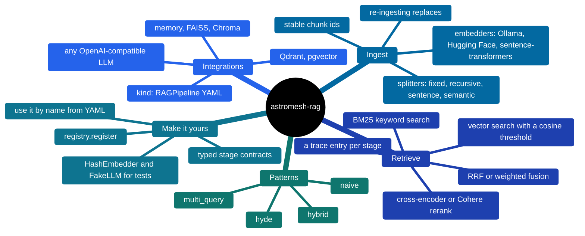
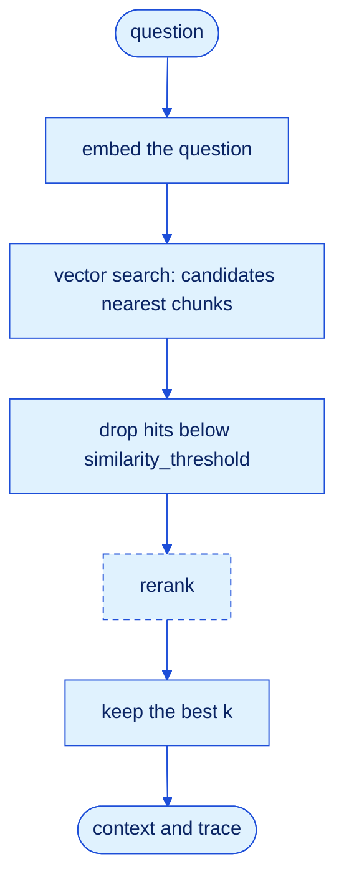
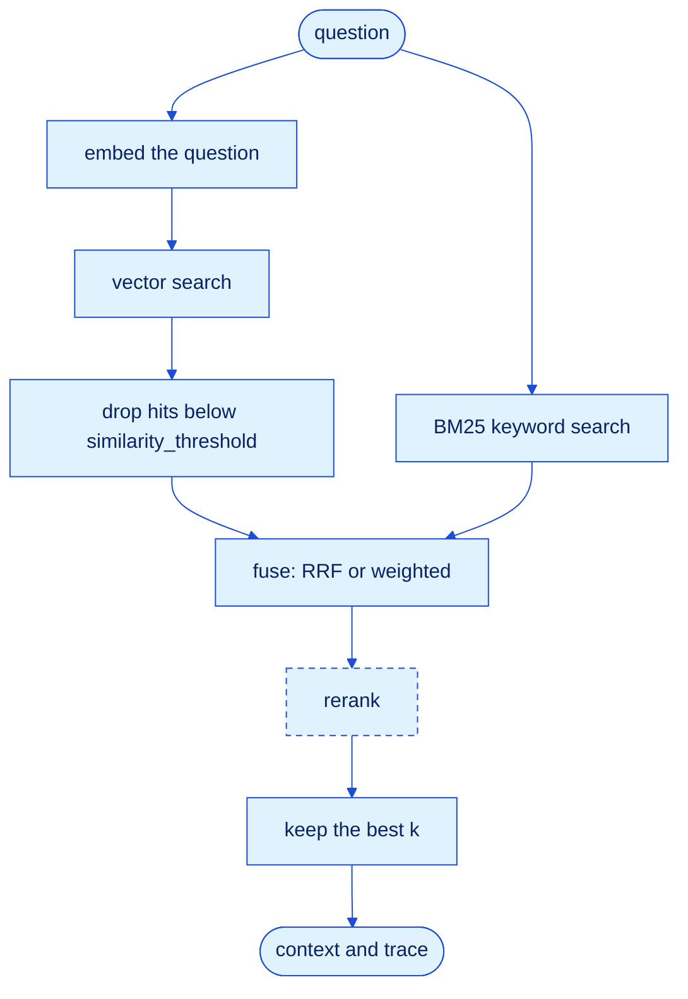
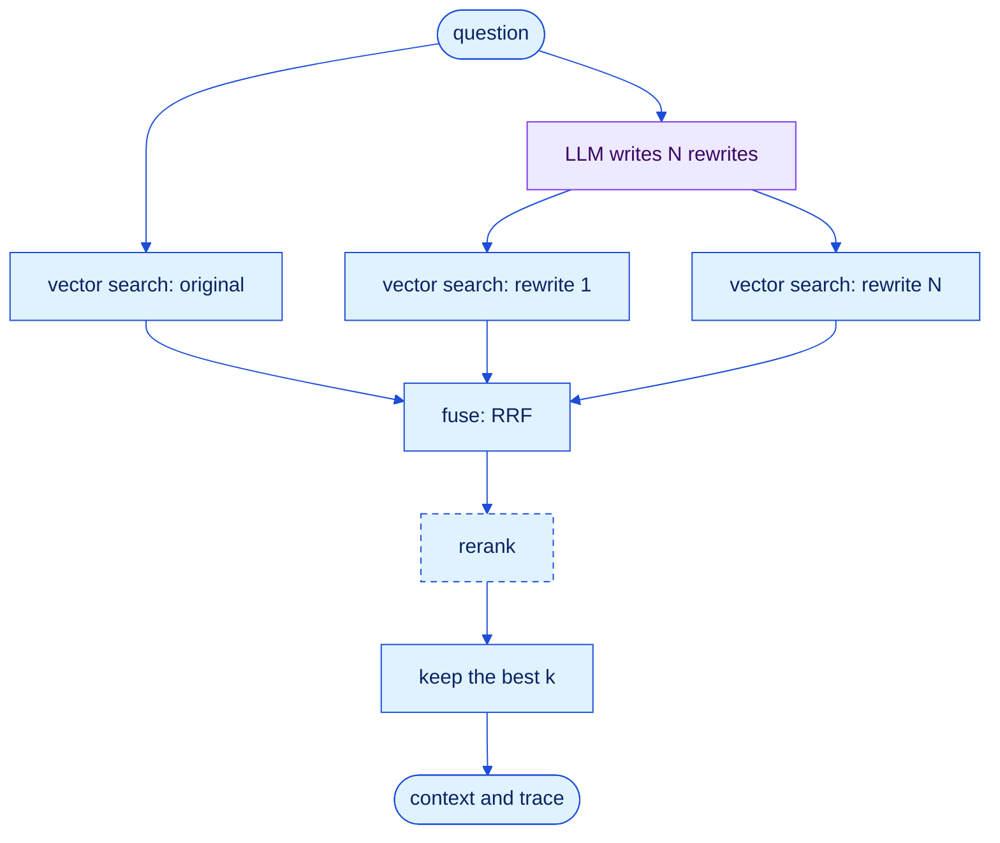
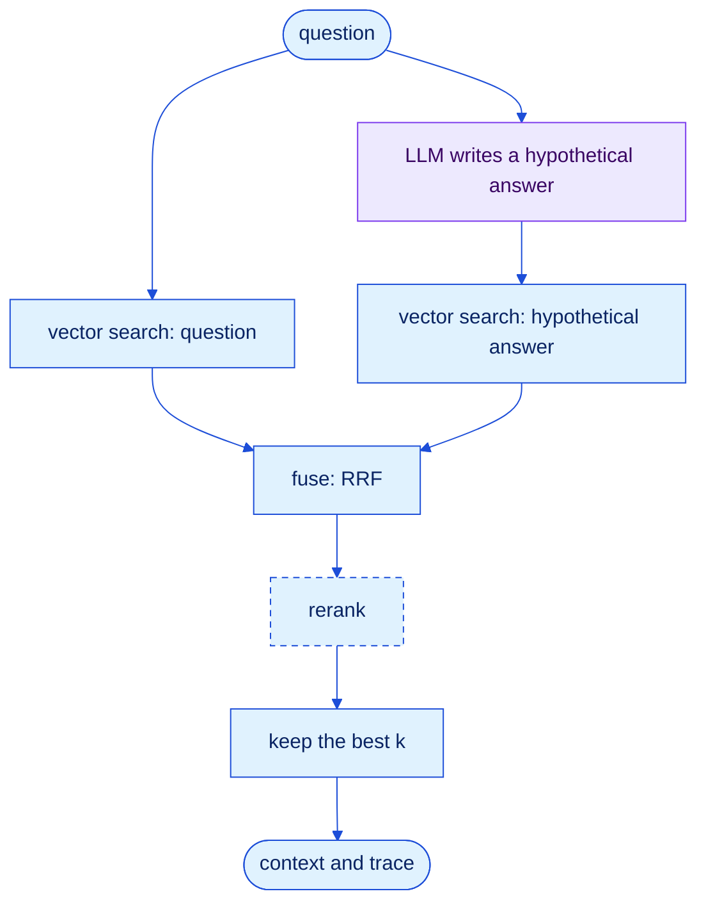
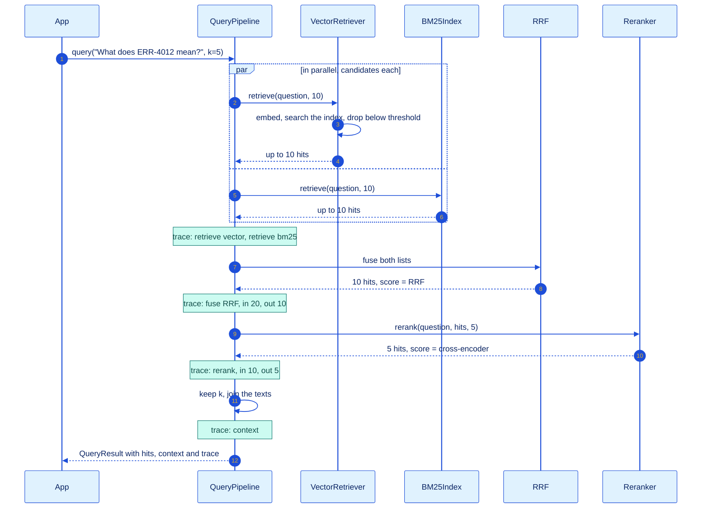

<p align="center">
  
</p>

# astromesh-rag

**Every RAG pattern, one set of parts.**

[](https://monaccode.github.io/astromesh/#ecosystem)
[](https://github.com/monaccode/astromesh-rag/releases)
[](https://github.com/monaccode/astromesh-rag/actions/workflows/ci.yml)
[](https://pypi.org/project/astromesh-rag/)
[](https://pypi.org/project/astromesh-rag/)
[](https://github.com/monaccode/astromesh-rag/blob/main/LICENSE)

*[Leer en español](https://github.com/monaccode/astromesh-rag/blob/main/README.es.md)*

Retrieval-augmented generation (RAG) gives a model the documents it needs to answer, at the
moment it answers. Every RAG system does the same four things:

1. **Ingest.** Split your documents into chunks, turn each chunk into a vector, store it.
2. **Retrieve.** Turn the question into a vector and find the nearest chunks; optionally
   search keywords too, or let an LLM rewrite the question first.
3. **Rank.** Merge the lists, rerank the candidates with a sharper model, keep the best `k`.
4. **Answer.** Join the winners into a context block your model reads before it answers.

`astromesh-rag` builds each of those steps from small, swappable parts, in Python or in
YAML. The patterns (`naive`, `hybrid`, `multi_query`, `hyde`) are just different wirings of
the same parts, so you can switch pattern by changing one line and see exactly what each
stage did in the `trace`. The library itself depends only on PyYAML; every model and database is an
optional extra.



## Patterns

A pattern decides how the question becomes candidates. Everything after that (fusion,
optional reranking, the top `k`, the context) is shared.

| Pattern | Built for | Work per query | Needs an LLM? |
|---|---|---|---|
| `naive` | Questions worded like the documents | 1 embedding, 1 vector search | No |
| `hybrid` | Exact tokens: error codes, SKUs, names, versions | 1 embedding, vector and BM25 in parallel, fusion | No |
| `multi_query` | Users who say it differently from the docs | 1 LLM call, then 1 + N embeddings and searches, fusion | Yes |
| `hyde` | Short questions against long reference text | 1 LLM call, then 2 embeddings and searches, fusion | Yes |

Reranking is a switch on any pattern: a cross-encoder (or Cohere) rescores the
candidates, which costs one extra model pass over `candidates` texts. Every vector search
drops hits below `similarity_threshold` when you set one. In the diagrams, dashed boxes are
optional and violet boxes call the LLM.

### naive

Embed the question, take the nearest chunks.



### hybrid

Vector search and BM25 keyword search run at the same time; reciprocal rank fusion (RRF)
merges the two rankings. BM25 is what finds `ERR-4012` when the embedding cannot tell it
from `ERR-4013`.



### multi_query

An LLM rewrites the question N ways (3 by default). The original and every rewrite are
searched, and RRF rewards the chunks that several wordings agree on.



### hyde

Hypothetical document embeddings: an LLM writes the passage that *would* answer the
question, and that passage is searched next to the question itself. A paragraph looks more
like a paragraph than a one-line question does.



Ideas, stages, YAML and failure modes for each one:
**[docs/patterns.md](https://github.com/monaccode/astromesh-rag/blob/main/docs/patterns.md)**.

## One hybrid query, stage by stage

Every query returns a `QueryResult` with the hits, the context and a `trace`: one entry
per stage (the green notes below) with its name, time in milliseconds, how many items went in and out, and the
error if it failed. In `hybrid`, a failing retriever is recorded in the trace and the
other one's hits are used; only both failing raises `StageError`.



Each hit keeps every score it collected in `details` (`vector`, `bm25`, `rrf`, `rerank`)
and says who found it in `source` (`vector`, `bm25` or `bm25+vector`).

## Benchmark

Which pattern should you use? The repo ships a simulated corpus built to make retrieval
fail in specific, labeled ways, and a script that ranks the four patterns on it, with and
without a reranker.

**The corpus.** [Nimbus](https://github.com/monaccode/astromesh-rag/blob/main/examples/corpus/README.md)
is the documentation of a fictional cloud-storage service: 200 documents (Spanish first,
about 20 % English) and 60 hand-labeled questions.

| Family | Docs | Trap | What makes it hard |
|---|---|---|---|
| Error articles | 40 | `exact` | Sibling codes (`ERR-4012` / `ERR-4013`) share almost every word |
| Plans | 20 | `exact` | Monthly and annual SKUs differ only in limits and price |
| Billing and account FAQs | 50 | `paraphrase` | Formal wording that colloquial questions never use |
| Policies, 2024 and 2026 | 30 | `distractor` | Same title and text, different numbers; 2024 is superseded |
| Release notes and blog posts | 60 | `noise` | Reuse product words and error codes without answering anything |

**The questions** are typed the same way: 15 `exact` ("¿Qué significa ERR-4012?"),
20 `paraphrase` ("me cobraron dos veces este mes"), 15 `distractor` (only the 2026 policy
counts as correct) and 10 `noise`. Each type carries a hypothesis (BM25 wins on codes,
rewrites win on paraphrases, a reranker separates versions and pushes noise down) that the
run confirms or refutes.

**Metrics.** Rankings are scored per document (chunk hits deduplicated to their document):
recall@5, precision@5 and hit rate@5, MRR@10 and nDCG@10, plus p50/p95 latency of one
`query()` call and LLM calls per query.

**Models.** Embeddings: `sentence-transformers/all-MiniLM-L6-v2`. Reranker:
`cross-encoder/ms-marco-MiniLM-L-6-v2`. LLM for `multi_query` and `hyde`: Kimi through an
OpenAI-compatible gateway.

<!-- BENCHMARK_RESULTS -->

**Reproduce it.**

```bash
git clone https://github.com/monaccode/astromesh-rag && cd astromesh-rag
uv sync --extra sentence-transformers --extra openai
export RAG_BENCH_BASE_URL=https://your-gateway/v1 RAG_BENCH_API_KEY=... RAG_BENCH_MODEL=...
uv run python examples/benchmark.py --embedder st --rerank both --k 5 --out results/
```

It prints the overall and per-type tables and writes `results/<date>-st.json` with the
config, the corpus hash and every per-query row. Without `RAG_BENCH_*` it falls back to a
fake LLM, and `--embedder hash` uses a test embedder: both run offline and both print a
warning, because their scores mean nothing.

## Quickstart

```bash
pip install 'astromesh-rag[sentence-transformers]'
```

**Python.** Ingest two documents, ask with `hybrid`, read the context:

```python
import asyncio

from astromesh_rag import Document
from astromesh_rag.embedders import SentenceTransformersEmbedder
from astromesh_rag.indexes import MemoryIndex
from astromesh_rag.patterns import hybrid
from astromesh_rag.pipeline import IngestPipeline
from astromesh_rag.retrievers import BM25Index
from astromesh_rag.splitters import RecursiveSplitter

docs = [
    Document("ERR-4012: your upload link expired. Request a new one.", id="err-4012"),
    Document("ERR-4013: your storage quota is full. Free space or upgrade.", id="err-4013"),
]


async def main():
    embedder, index, bm25 = SentenceTransformersEmbedder(), MemoryIndex(), BM25Index()
    await IngestPipeline(RecursiveSplitter(), embedder, index, bm25).ingest(docs)
    result = await hybrid(embedder, index, bm25).query("What does ERR-4012 mean?", k=1)
    print(result.context)  # ERR-4012: your upload link expired. Request a new one.
    print(result.trace)  # retrieve vector, retrieve bm25, fuse, context


asyncio.run(main())
```

**YAML.** The same `kind: RAGPipeline` format the Astromesh runtime loads:

```yaml
# support.rag.yaml
apiVersion: astromesh/v1
kind: RAGPipeline
metadata:
  name: support-docs
spec:
  chunking: { strategy: recursive, chunk_size: 800, overlap: 80 }
  embeddings: { provider: sentence_transformers, model: all-MiniLM-L6-v2 }
  vector_store: { backend: memory }
  reranking: { enabled: true, provider: cross_encoder, top_k: 5 }
  retrieval:
    pattern: hybrid
    top_k: 5
    candidates: 20
```

```python
from astromesh_rag.spec import build, load_spec_file

pipeline = build(load_spec_file("support.rag.yaml"))
await pipeline.ingest(docs)
result = await pipeline.query("What does ERR-4012 mean?")
```

`multi_query` and `hyde` need a model: `build(spec, llm=OpenAICompatLLM(base_url, api_key,
model))` works with any OpenAI-compatible endpoint (a gateway, Ollama, vLLM, OpenAI).
Every key and default: **[docs/spec.md](https://github.com/monaccode/astromesh-rag/blob/main/docs/spec.md)**.

## Extras

Splitters, BM25, fusion, the `memory` index and the test doubles need nothing beyond
PyYAML. Everything else is an extra; a missing one raises `MissingExtraError` with the
exact `pip install 'astromesh-rag[...]'` to run, when the pipeline is built.

| Extra | Installs | Unlocks |
|---|---|---|
| `sentence-transformers` | `sentence-transformers` | `embeddings.provider: sentence_transformers`, `reranking.provider: cross_encoder` |
| `ollama` | `httpx` | `embeddings.provider: ollama` |
| `hf` | `httpx` | `embeddings.provider: hf` (Inference API or TEI) |
| `faiss` | `faiss-cpu`, `numpy` | `vector_store.backend: faiss` |
| `chroma` | `chromadb` | `vector_store.backend: chroma` |
| `qdrant` | `qdrant-client` | `vector_store.backend: qdrant` |
| `pgvector` | `asyncpg` | `vector_store.backend: pgvector` |
| `cohere` | `httpx` | `reranking.provider: cohere` |
| `openai` | `httpx` | `OpenAICompatLLM` for `multi_query` and `hyde` |
| `all` | all of the above | everything |

## Make it yours

Every stage is a small async protocol (`Splitter`, `Embedder`, `VectorIndex`, `Retriever`,
`QueryTransform`, `Reranker`, `LLM`) and every name in the YAML comes from one registry.
Register a factory and your component is usable by name, with no fork:

```python
from astromesh_rag import registry
from astromesh_rag.indexes import MemoryIndex


class LoggingIndex(MemoryIndex):
    async def search(self, vector, k, filters=None):
        hits = await super().search(vector, k, filters)
        print(f"search returned {len(hits)} hits")
        return hits


registry.register("index", "logging", lambda cfg, ctx: LoggingIndex())
```

```yaml
vector_store: { backend: logging }
```

Registering an existing name replaces the built-in, which is how a runtime can put a faster
chunker behind `chunking.strategy: recursive`. `astromesh_rag.testing` ships `HashEmbedder`
and `FakeLLM` so your tests run without a network or a model. A full vector database
adapter and a custom query rewrite, step by step:
**[docs/extending.md](https://github.com/monaccode/astromesh-rag/blob/main/docs/extending.md)**.

## How Astromesh uses it

This library started as the RAG layer inside the [Astromesh](https://github.com/monaccode/astromesh)
agent runtime and was extracted so that anyone can use it, the same move made with
[astromesh-okf](https://github.com/monaccode/astromesh-okf). **The plan for the next core
release** (not shipped yet) is that the core delegates all of its RAG to this library and
keeps only the wiring: `astromesh/rag` becomes a thin facade with today's names, every
existing `kind: RAGPipeline` file keeps loading unchanged, the core's model router becomes
the `LLM` for `multi_query` and `hyde`, and its Rust chunker registers over
`chunking.strategy: recursive`.

Porting the code out surfaced bugs in the core's implementation. They are fixed here and listed in the [CHANGELOG](https://github.com/monaccode/astromesh-rag/blob/main/CHANGELOG.md):

**A second ingestion overwrote the first.** Chunk ids were `doc_0`, `doc_1`… for every
document, so ingesting document B replaced document A. Ids are now `<doc_id>#<n>`, and
re-ingesting a document deletes its old chunks first instead of leaving stale ones behind.

**Two YAML keys were accepted and ignored.** `retrieval.similarity_threshold` now drops
vector hits below that cosine (never applied to reranker scores, which are not on a 0–1
scale), and `reranking.top_k` now caps the reranker's output.

**Each backend failed differently.** Qdrant rejected string point ids (they are now UUIDv5
of the chunk id), pgvector built filters by interpolating SQL (now bound parameters),
Chroma ranked by L2 distance (now cosine, like the others), and `semantic` chunking from
YAML silently fell back to sentence splitting because no embedder reached it.

**An overlap at least as large as the chunk hung the splitter.** `overlap >= chunk_size`
is now a `SpecError` at build time.

## Roadmap

v0.1 is the foundation: the stage contracts, the port of the core, four patterns, retrieval
metrics and the benchmark. Each later phase gets its own spec and release.

| Phase | Scope |
|---|---|
| 2: Patterns | Parent-document, contextual retrieval, corrective RAG (CRAG), self-RAG, agentic loop, GraphRAG, RAPTOR |
| 3: Providers | Managed RAG as a retriever or index (Vertex AI RAG Engine, Bedrock Knowledge Bases, Azure AI Search, OpenAI file search); Pinecone, Weaviate, Elasticsearch/OpenSearch, Milvus; native hybrid search where the database has it |
| 4: Evaluation | Generation metrics (faithfulness, answer relevance, context precision), LLM-as-judge, a bridge to the runtime's `kind: Eval` |
| 5: Reach | File loaders (PDF, HTML, Markdown, Office), LangChain and LlamaIndex adapters, an MCP server, a CLI |

## Contributing

Issues and pull requests are welcome. [CONTRIBUTING.md](https://github.com/monaccode/astromesh-rag/blob/main/CONTRIBUTING.md)
covers setup, tests (including the integration jobs) and how to add a backend.

## License

[Apache-2.0](https://github.com/monaccode/astromesh-rag/blob/main/LICENSE). Part of the
[Astromesh](https://monaccode.github.io/astromesh/) ecosystem.
